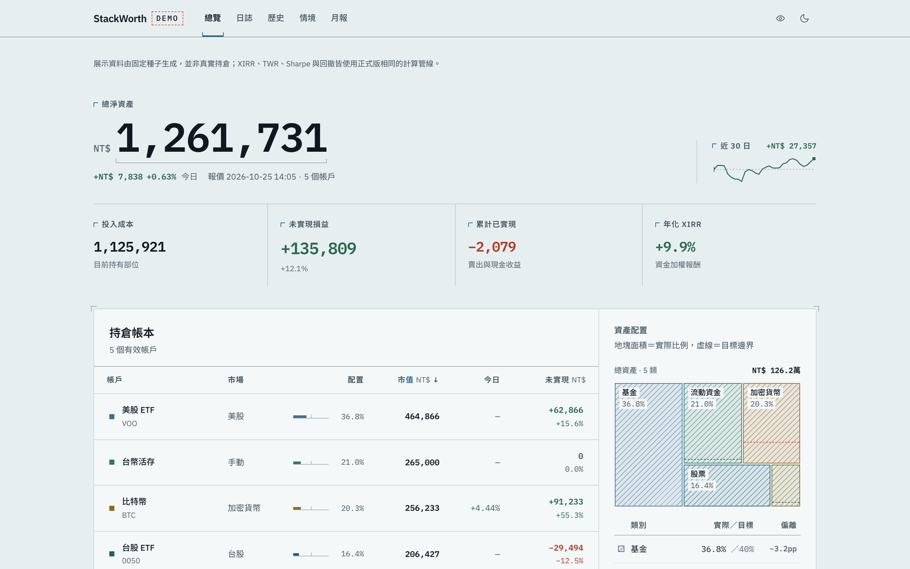
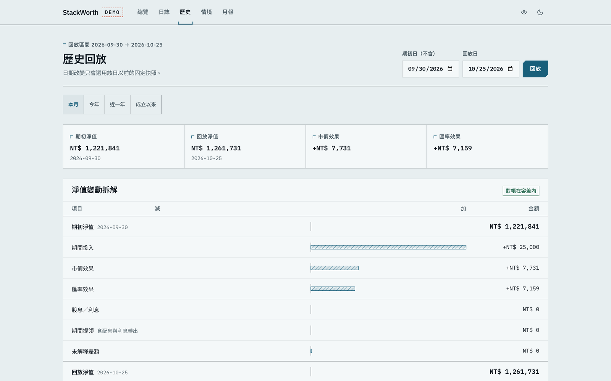
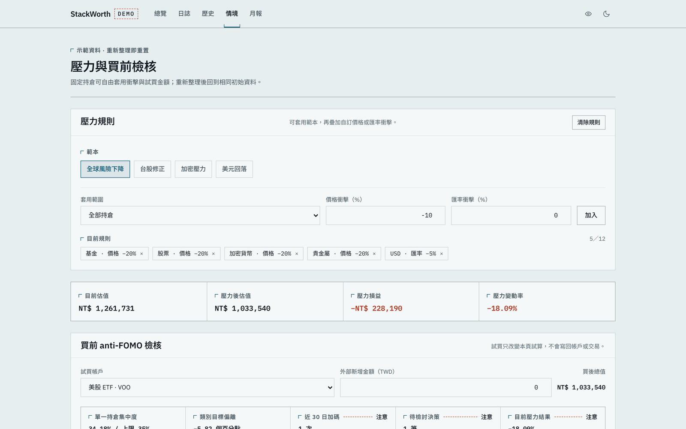
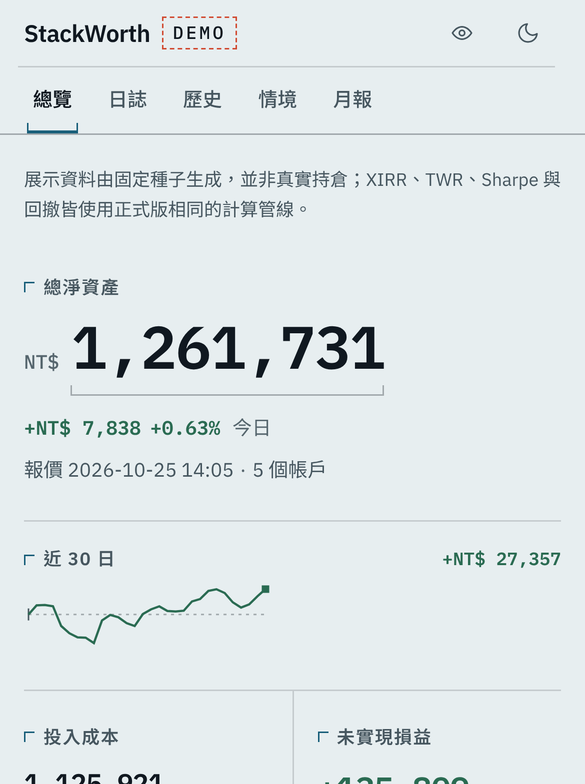

# StackWorth

[](https://github.com/wppypewo/portfolio-tracker/actions/workflows/ci.yml)
[](LICENSE)
[](CHANGELOG.md)

[English](README.md) | 繁體中文

個人投資組合追蹤工具。給長期投資、在多個帳戶持有美股 ETF、台股、加密貨幣與手動資產的人，全部折成台幣放在同一個儀表板。

**正式站：** https://portfolio-tracker-two-rho.vercel.app · **公開示範（免登入）：** https://portfolio-tracker-two-rho.vercel.app/demo · **完整參考：** [docs/REFERENCE.md](docs/REFERENCE.md)

個人理財工具。不是投資建議，與任何機構無關，也不是商業產品。

<picture>
  <source media="(prefers-color-scheme: dark)" srcset="docs/screenshots/overview-dark.png">
  
</picture>

<sub>公開示範，資料由程式產生。明暗主題跟著你的 GitHub 設定。</sub>

---

## 要解決的問題

資產分散在不同市場和幣別時，券商 App 只看得到各自那一塊。試算表抓不到即時報價，也很難維持乾淨的投入紀錄。我要的東西沒有一個地方同時做到：XIRR 與 TWR 並列、現金流正負號正確、只算目前實際持有的組合、用我自己的基準幣別。

## 限制條件

- **資料是真的錢。** 指標算不可靠時，畫面顯示「—」，不給估計值。
- **免費額度的報價 API**（Twelve Data、FinMind、CoinGecko），有呼叫次數與歷史長度的硬上限。刷新路徑有冷卻時間，缺的資料畫成看得見的斷點，不內插。
- **每天在手機上用。** 圖表可觸控拖曳、可安裝成 PWA、一鍵遮蔽金額方便在公共場所打開。
- **一個人做。** 每條寫入路徑、每個指標和邊界情況都要能便宜地驗證，所以有下面的五道關卡。

## 設計決策

**一條計算管線，兩個呼叫端。** 儀表板的計算全部在 `buildDashboardData`，這是沒有 I/O 的純函式。正式頁面餵它 Supabase 的資料列，公開的 `/demo` 餵它固定規則產生的資料。所以示範頁不是假畫面：上面的 XIRR、TWR、Sharpe 與回撤，和我真實組合用的是同一份程式碼。

**XIRR 與 TWR 的現金流正負號刻意相反。** XIRR 站在投資人錢包的角度（投入為負，期末組合價值以正數附加在最後）；TWR 站在組合的角度（投入為正，期末價值不附加，因為它已經在最後一筆快照裡，附加的話最後一個子區間的報酬會變成零）。正負號只在一個有註明的地方翻轉，並有回歸測試釘住「誤用期末價值」這個情況。

**XIRR 求解器回傳前先驗殘差。** Newton-Raphson 迴圈的每個出口都檢查 `|NPV(rate)|` 是否在相對尺度的容差內；震盪、導數趨近零、達到迭代上限，一律回傳 null，不回傳殘差值。

**儀表板只算目前有效的組合。** 摘要數字、趨勢線、績效指標、收益統計與資產配置共用同一個「有效帳戶」範圍。顯示已封存帳戶只會讓持倉帳本多幾列，不會改變儀表板總額，也不會在 TWR 上看起來像一次價值下跌。

**風險指標保留現金流與時間的邊界。** 最大回撤用經現金流調整的 TWR 指數計算，提領不會被當成市場虧損。Sharpe 把不規則的快照間隔換算成等效日報酬，並以日曆日年化，因為組合裡有週末也交易的資產。

**定期定額有帳本、可重複執行。** cron 與手動執行都先抓最新報價，再呼叫同一支 Postgres RPC。這支函式鎖住計劃與帳戶，從資料庫當下的值算出股數增量，寫入交易與快照、記錄這一期已執行，並推進下一期，全部在同一個交易裡。`(plan_id, scheduled_date)` 唯一鍵讓重試和連按兩次都不會重複扣款。

**失敗狀態看得見。** 基準指數抓取失敗時回傳空值，圖上用虛線段接過缺口；開啟的對照線先對齊同一個起始日再標準化成 100；CoinGecko 的歷史長度上限讓 BTC 顯示成較晚開始的序列；service worker 只快取離線頁，因為顯示過期的財務數字比載不出來更糟；價格 cron 漏跑時，設定頁的資料健康卡會變紅。

**決策當下的脈絡只寫一次。** 每筆決策保存建立當下看到的價格、匯率、持倉、配置、成本、未實現損益與組合總值。資料庫 trigger 拒絕事後修改這些脈絡，但論點、檢討日期等使用者自己寫的欄位仍可更正。

**歷史頁面不借用今天的報價。** 回放使用所選日期當天或之前最近一筆快照，延用的數值會標出來源日期，缺的資料直接顯示。歸因公式保留一個看得見、按尺度計算的殘差，不把拆不完的部分藏起來。

## 功能流程

- **決策日誌：** 在 `/decisions` 建立交易前或交易後的紀錄，可連結到某筆變動紀錄，保存當下脈絡，排定檢討日，結果與過程分開記錄。
- **歷史回放與歸因：** 在 `/history` 選一個日期，查看當時的持倉、封存邊界、報價日期、配置、幣別曝險，以及可對帳的變動拆解。
- **壓力測試與買前檢核：** 在 `/whatif` 的組合壓力分頁疊加價格與匯率衝擊，再試算一筆外部新增的買入，不寫回帳本。
- **月報：** 在 `/reports/monthly` 選月份，檢視報酬、歸因、配置、決策、資料缺口與資料健康，再用瀏覽器列印成 PDF。

## 驗證

- 每個 server action 的輸入在碰資料庫前都過 Zod schema；底下還有 Supabase RLS 與 TOTP MFA（AAL2）。
- 合併前跑五道關卡：lint、型別檢查、Vitest 單元測試、Postgres 整合測試、production build，GitHub Actions 跑同一套。
- 測試針對不變量：XIRR 殘差驗證、TWR 現金流隔離、經現金流調整的回撤、不規則快照間隔、已封存帳戶的範圍、示範資料的決定性、server action 的授權與冷卻邊界、定期定額的併發與回滾，以及在真實 Postgres 上跑的原子寫入 RPC。
- 日期換算一律明確指定 `Asia/Taipei`。Vercel 跑在 UTC，快照日期差一天就會讓當日變動與 TWR 算錯。

## 示範

https://portfolio-tracker-two-rho.vercel.app/demo ，不需要帳號。

資料由程式產生：18 個月的定期定額紀錄，用固定種子的隨機漫步，中間安排一段修正、一筆已實現虧損，以及配息與利息。同一天內結果固定，回訪時看到的數字相同。正式儀表板存的是個人財務資料，所以本 repo 的截圖全部取自示範頁。

| 歷史回放與歸因 | 壓力測試與買前檢核 |
|---|---|
|  |  |



示範流程有 `/demo/decisions`、`/demo/history`、`/demo/whatif` 與 `/demo/report`，只用固定資料，不會查詢任何登入使用者的組合。

登入後的版本仍可遮蔽金額。列印的月報會標明產生時金額是否可見；在共用裝置上存 PDF 前先確認這一點。

## 本機執行

```bash
git clone https://github.com/wppypewo/portfolio-tracker
cd portfolio-tracker
npm install
cp .env.local.example .env.local   # 填入設定值，變數表見 docs/REFERENCE.md
npm run dev
```

關卡：`npm run lint` / `npm run typecheck` / `npm run test:unit` / `TEST_DATABASE_URL=... npm run test:integration` / `npm run build`。

## 現況與下一步

正式運作中（Vercel + Supabase，單一使用者）。每次推送到 main，CI 會跑 lint、型別檢查、單元測試、Postgres 整合測試與 build。目前版本是 **v1.3.0**（2026-10-25）：定期定額級距加減碼、校正成本、公開介紹頁 `/about`、資料庫層強制 MFA，以及一批台北時間的日期修正。每個版本列出需要套用的 SQL migration，完整順序見 [supabase/README.md](supabase/README.md)。

已知限制：回放與月報的快照查詢有上限，被截斷或缺報價時會標出來；檢討頁的效能取決於已存的每日快照；PDF 靠瀏覽器列印；登入後的建立與檢討流程需要設定好的 Supabase 專案。見 [docs/REFERENCE.md](docs/REFERENCE.md) 與 [CHANGELOG.md](CHANGELOG.md)。

## 延伸閱讀

- [docs/ARCHITECTURE.md](docs/ARCHITECTURE.md)：模組邊界與寫入路徑（英文）
- [docs/ADR-001-stackworth-v1-data-semantics.md](docs/ADR-001-stackworth-v1-data-semantics.md)：v1 的資料語意
- [docs/DESIGN_NOTES.md](docs/DESIGN_NOTES.md)：設計決策與取捨，附實測數字
- [SECURITY.md](SECURITY.md)：如何回報漏洞

## 作者

[@wppypewo](https://github.com/wppypewo)，為自己的多資產、多幣別組合做的每日工具。

## 授權

[MIT](LICENSE)。
